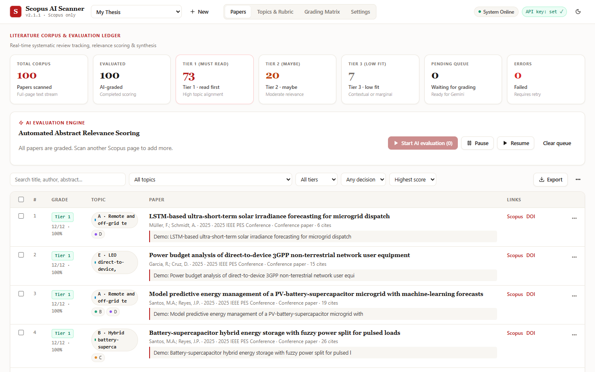

# Scopus AI Scanner V2

> Bulk-scan the abstracts on a **Scopus** results page and let a **free** AI grade them against **your own thesis topics** — while you keep using your computer.

A Chrome / Edge extension plus a local dashboard. Built by a student, for students doing a literature review (RRL).



## What it does

1. **You** search Scopus, show **100 results per page**, and (optionally) click *Show abstract*.
2. **One click** on the floating panel → the extension reads every card (title, authors, year, source, citations, DOI, abstract), expanding the remaining abstracts and scrolling the page itself.
3. The papers appear in a **dashboard tab** (local to your browser). You review them, then press **Start AI evaluation**.
4. A free **Gemini** model grades each paper against **your topics and rubric** and extracts deep notes (method, scale, validation, metrics, limitations, research gap, suggested RRL section…).
5. You get a **grading matrix per topic**, filters, and exports to **Excel (live formulas)**, **CSV** and **BibTeX**.

It is **Scopus-only on purpose** (no other libraries) so behaviour stays predictable.

### It does not take over your computer
Everything happens *inside the Scopus tab* using DOM calls — no real mouse movement, no keyboard simulation, no focus stealing, no separate browser. The dashboard opens in the background. Keep working in other tabs or apps. (If a list lazy-loads and Chrome hides the tab, the panel warns you; see *Troubleshooting*.)

### Flexible — not tied to one thesis
Topics, keywords, grading criteria and the “deep note” fields are all editable in the dashboard, saved per **project**. Start blank, add your research topics and keywords manually, or let the AI suggest topics directly from your thesis title.

## Install (2 minutes)

1. Download or `git clone` this repo.
2. Open `chrome://extensions` → turn on **Developer mode** → **Load unpacked** → choose this folder.
3. Pin the extension (puzzle icon → pin) so the ⚡ icon is visible.
4. Get a free API key at <https://aistudio.google.com/apikey> (Google account only — **no credit card**).
5. Open the dashboard (click the icon → *Open dashboard*) → **Settings** → paste the key → **Save** → **Test key**.

Full walkthrough with screenshots: [`docs/Scopus-AI-Scanner-V2-Tutorial.pdf`](docs/Scopus-AI-Scanner-V2-Tutorial.pdf)

## Everyday workflow

| Step | Where | What |
|---|---|---|
| 1 | Dashboard → *Topics & Rubric* | Describe your thesis, add topics + keywords (or ✨ suggest). Press *Copy & open Scopus advanced search* on a topic. |
| 2 | Scopus | Run the search, set **100** results per page. |
| 3 | Scopus | Floating panel (bottom-right) → **Scan this page → Dashboard**. |
| 4 | Dashboard → *Papers* | Review the imported list. Instant keyword hits show a preview before any AI call. |
| 5 | Dashboard | **Start AI evaluation** (≈ 4 s per paper → ~7 min for 100). Pause/resume any time. |
| 6 | Dashboard | Filter by topic/tier, open a paper for deep notes, mark Include/Maybe/Exclude. |
| 7 | Dashboard → *Grading Matrix* | See Tier 1/2/3 per topic and the paper × topic heat-map. |
| 8 | Dashboard → *Export* | `.xlsx` (Screening · Topic Matrix · Deep Notes · Topics & Rubric · Settings), `.csv`, `.bib`. |

Scanning the same page twice never creates duplicates (matched by DOI / Scopus id / title).

## Free-tier notes (Gemini)
- Uses the **Gemini Interactions API** with structured JSON output. Default model `gemini-3.8-flash`; `gemini-3.5-flash-lite` is also offered (lighter, better for huge batches).
- The free tier is rate-limited (≈15 requests/min and a daily cap). The queue paces itself (default **4 s** between requests), retries on `429`, and **pauses with a clear message** if the quota is used up — press *Resume* later. Progress is saved after every paper.
- Only the **title/abstract/metadata** of each paper is sent to Google, and only when you press *Start AI evaluation*. On the free tier Google may use submitted data to improve its products — don’t send anything you consider confidential. Your API key is kept in `chrome.storage.local` of your own browser profile.
- The AI only sees the abstract, so notes say *“not stated in abstract”* instead of guessing. Always verify against the full paper before citing.

## Privacy
No servers, no analytics, no accounts. Data lives in your browser (IndexedDB). Network calls: Scopus (the page you are already on), Google Gemini (grading), and — only if you use the buttons — CrossRef (find missing DOIs) and Unpaywall (free PDFs).

## Project layout

```
manifest.json            MV3 manifest
background.js            service worker: scan inbox, opens dashboard without stealing focus
content/scopus-scanner.js  in-page scanner + floating panel (shadow DOM)
popup/                   toolbar popup (open dashboard / show panel on proxy URLs)
dashboard/               dashboard UI (ES modules)
  js/scoring.js          grading math, tiers, matrix        (pure, unit-tested)
  js/gemini.js           schema builder, prompts, retries   (pure, unit-tested)
  js/queue.js            rate-limited AI queue
  js/exporter.js         CSV / BibTeX / Excel with live formulas
  js/db.js               IndexedDB wrapper
shared/default-preset.js blank + sample presets
tests/                   unit tests, mock-Scopus fixture, end-to-end test
docs/                    tutorial PDF + screenshots
```

## Development

```bash
npm install          # only needed for the end-to-end test (puppeteer-core)
npm test             # unit tests (no browser needed)
npm run test:e2e     # loads the real extension in Chrome against a mock Scopus page
```

The E2E test also regenerates the screenshots in `docs/screenshots/` (they show **demo data** from a mock page, not real Scopus content).

## Troubleshooting
- **Panel doesn’t appear** — Scopus open through a university proxy address? Click the toolbar icon → *Show scanner on this tab*.
- **“No result cards detected”** — make sure the results list (not the Scopus home page) is open. Scopus changes its layout occasionally; the scanner finds cards via their record links, but please open an issue with the page URL pattern if it fails.
- **Some papers have no abstract** — click *Show abstract* on them and scan again; already-imported papers are skipped.
- **Fewer papers than the page claims** — Chrome pauses hidden tabs; if a list lazy-loads, keep the Scopus tab visible (a separate window works) and scan again.
- **`Free-tier quota reached`** — wait a minute (per-minute limit) or until tomorrow (daily limit), then press *Resume*.
- **Sci-Hub link** is off by default; enable in Settings only if permitted by your institution and local law.

## Contributing
PRs welcome — especially: Scopus layout fixes, translations, more presets (other fields of study), other free AI back-ends. Please run `npm test` first.

## License
MIT — see [LICENSE](LICENSE).
